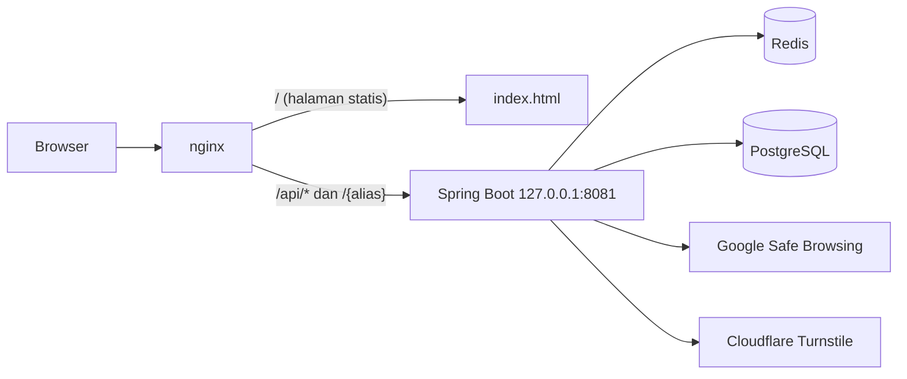

# URL Shortener

Layanan pemendek URL yang dibuat dengan Spring Boot dan PostgreSQL. Pengguna memilih alias sendiri, memasukkan URL tujuan, lalu mendapat link pendek yang mengarahkan ke URL itu. Proyek ini dibuat untuk belajar membangun satu layanan dari desain sampai pengujian, termasuk perlindungan terhadap penyalahgunaan dan pengukuran performa.

## Fitur

- Alias buatan pengguna, 5 sampai 50 karakter: huruf, angka, `-`, dan `_`. Alias `health`, `admin`, `actuator`, dan `static` dilarang.
- Redirect `302` lewat `GET /{alias}`. Link kedaluwarsa otomatis 90 hari setelah dibuat.
- Batas 10 percobaan per menit untuk setiap IP. Mulai percobaan ke-6, pengguna harus menyelesaikan CAPTCHA Cloudflare Turnstile.
- URL tujuan diperiksa dengan Google Safe Browsing. Jika Google tidak bisa dihubungi, link tidak dibuat.
- Hanya URL `http` dan `https` yang diterima, panjang URL maksimal 2048 karakter, dan URL ke domain layanan sendiri ditolak.
- Cache Redis untuk redirect. Jika Redis mati, redirect tetap jalan lewat database.
- Antarmuka web satu halaman dengan mode terang dan gelap serta tombol salin link.

## Arsitektur



nginx menyajikan halaman statis dan meneruskan permintaan lain ke Spring Boot. Spring Boot hanya mendengarkan alamat loopback, jadi semua akses dari luar lewat nginx. IP klien dikirim lewat header `X-Forwarded-For`, dan rate limiter memakai IP itu.

**Alur pembuatan link.** Interceptor menjalankan rate limiter dan CAPTCHA lebih dulu. Setelah itu service memvalidasi alias dan URL, memeriksa alias ganda, memeriksa URL ke Google Safe Browsing, lalu menyimpan ke PostgreSQL. Pemeriksaan alias ganda sengaja ada sebelum panggilan ke Google, supaya permintaan yang pasti ditolak tidak memakai kuota API. Database punya batasan yang sama (format alias, panjang URL) sebagai lapisan kedua.

**Alur redirect.** Aplikasi mencari alias di Redis. Jika tidak ada, aplikasi membaca dari PostgreSQL lalu menyimpan hasilnya ke Redis. Link yang sudah kedaluwarsa tidak disimpan ke cache, dan masa hidup cache tidak pernah melebihi sisa umur link maupun 24 jam. Timeout koneksi Redis 200 ms, sehingga request tidak menunggu lama saat Redis mati.

## Teknologi

Java 25, Spring Boot 4.1.2, Maven, PostgreSQL, Flyway, Redis 7, nginx, JUnit dan Mockito, k6 untuk benchmark, Jenkins untuk CI.

## Menjalankan di lokal

Prasyarat: JDK 25, PostgreSQL, Docker, dan nginx jika ingin memakai antarmuka web.

**1. Database.** Buat role dan database. Flyway membuat tabel saat aplikasi pertama kali jalan.

```sql
CREATE ROLE urlshortener LOGIN PASSWORD 'ganti-dengan-password-anda';
CREATE DATABASE urlshortenerdb OWNER urlshortener;
```

**2. Redis.**

```bash
docker run -d --name urlshortener-redis --restart unless-stopped \
  -p 127.0.0.1:6379:6379 redis:7-alpine redis-server --save "" --appendonly no
```

**3. Konfigurasi.** Salin `.env.example` menjadi `.env` di root proyek, lalu isi nilainya. File `.env` masuk `.gitignore` dan tidak boleh di-commit. Aplikasi membaca `.env` dari direktori tempat ia dijalankan, jadi jalankan dari root proyek.

| Variabel | Fungsi |
|---|---|
| `DB_NAME`, `DB_USERNAME`, `DB_PASSWORD` | Koneksi PostgreSQL |
| `SAFE_BROWSING_API_KEY` | API key Google Safe Browsing. Buat di Google Cloud dan batasi hanya untuk Safe Browsing API |
| `SAFE_BROWSING_ENABLED` | `true` secara bawaan. `false` melewati pemeriksaan |
| `TURNSTILE_SITE_KEY`, `TURNSTILE_SECRET_KEY` | Kunci Cloudflare Turnstile |
| `TURNSTILE_ENABLED` | `true` secara bawaan. `false` mematikan kewajiban CAPTCHA |
| `APP_HOST` | Nama host layanan, `localhost` secara bawaan. Isi dengan domain saat memakai tunnel. Dipakai untuk menolak URL tujuan ke domain sendiri |
| `APP_CACHE_ENABLED` | `false` mematikan cache Redis, dipakai sebagai kontrol saat benchmark |

Untuk pengembangan, Cloudflare menyediakan kunci uji. Site key `1x00000000000000000000AA` dengan secret key `1x0000000000000000000000000000000AA` membuat semua token lolos. Secret key `2x0000000000000000000000000000000AA` membuat semua token ditolak. Kunci uji tidak boleh dipakai di produksi.

**4. Aplikasi.**

```bash
./mvnw spring-boot:run
```

Aplikasi berjalan di `127.0.0.1:8081`.

**5. Antarmuka web.** Konfigurasi nginx ada di `deploy/nginx/urlshortener.conf`.

```bash
sudo mkdir -p /var/www/urlshortener
sudo cp frontend/index.html /var/www/urlshortener/index.html
sudo cp deploy/nginx/urlshortener.conf /etc/nginx/sites-available/urlshortener
sudo ln -s /etc/nginx/sites-available/urlshortener /etc/nginx/sites-enabled/urlshortener
sudo nginx -t && sudo systemctl reload nginx
```

Buka `http://localhost/`.

## API

### Membuat link

```bash
curl -X POST http://localhost/api/links \
  -H "Content-Type: application/json" \
  -d '{"longUrl":"https://spring.io","alias":"contoh123"}'
```

```json
{
  "alias": "contoh123",
  "shortUrl": "http://localhost/contoh123",
  "longUrl": "https://spring.io",
  "expiredAt": "2027-01-26T01:44:11.693086468Z"
}
```

Token CAPTCHA dikirim lewat header `X-Turnstile-Token`.

| Status | Arti |
|---|---|
| `201` | Link dibuat |
| `400` | Alias atau URL tidak valid, alias dilarang, atau URL ditandai berbahaya oleh Google Safe Browsing |
| `403` | CAPTCHA diperlukan, atau token ditolak. Body memuat `captchaRequired` dan `siteKey` |
| `409` | Alias sudah dipakai |
| `429` | Melewati 10 percobaan per menit. Header `Retry-After` bernilai `60` |
| `503` | Google Safe Browsing atau Turnstile tidak bisa dihubungi |

Galat dari aplikasi dikirim dalam format `application/problem+json`.

### Membuka link

`GET /{alias}` mengembalikan `302` dengan header `Location` berisi URL tujuan. Alias yang tidak ada mengembalikan `404`, dan link yang sudah kedaluwarsa mengembalikan `410`.

## Rate limit dan CAPTCHA

Rate limiter memakai jendela tetap 60 detik per IP, dimulai dari percobaan pertama. Hitungan disimpan di memori aplikasi.

| Percobaan dalam satu jendela | Hasil |
|---|---|
| 1 sampai 5 | Diproses |
| 6 sampai 10 | Perlu token CAPTCHA yang valid. Percobaan yang ditolak karena CAPTCHA tetap dihitung |
| 11 ke atas | Ditolak dengan `429`, token valid tidak membantu |

Percobaan yang diblokir tidak menambah hitungan, jadi blokir tidak diperpanjang dan berakhir saat jendela 60 detik habis.

Skrip `scripts/turnstile-test.sh` menjalankan alur ini terhadap aplikasi yang sedang berjalan. Mode `body-expiry` memakai secret key yang selalu lolos, dan mode `rejected` memakai secret key yang selalu gagal.

## Keputusan desain

- **302, bukan 301.** Browser menyimpan `301` tanpa batas waktu, sehingga masa kedaluwarsa link tidak bisa ditegakkan.
- **410 untuk link kedaluwarsa, 404 untuk alias yang tidak ada.** Pengguna dan klien HTTP bisa membedakan link yang pernah ada dari link yang tidak pernah ada.
- **URL asli disimpan langsung di tabel `links`, tanpa deduplikasi.** URL yang sama dengan alias berbeda menjadi baris berbeda. Strukturnya lebih sederhana, dan alias dipilih sendiri oleh pengguna.
- **Safe Browsing menolak saat gagal.** Jika Google tidak bisa dipastikan menilai URL, link tidak dibuat. Perilaku ini bisa diubah lewat `safe-browsing.fail-open`.
- **Cache-aside di Redis.** Redis hanya cache, sumber data tetap PostgreSQL, sehingga kegagalan Redis tidak menghilangkan data.

## Pengujian

```bash
./mvnw test
```

Ada unit test untuk `LinkServiceImpl`, `RateLimiter`, `SafeBrowsingClient`, dan `TurnstileVerifier`, memakai JUnit dan Mockito. Test konteks Spring memerlukan PostgreSQL yang aktif.

`Jenkinsfile` mendefinisikan pipeline yang mengecek repositori setiap lima menit, menjalankan test, membuat jar, dan mengarsipkan jar itu. Pipeline memakai database `urlshortener_ci` dan kredensial Jenkins bernama `urlshortener-ci-db-password`.

## Benchmark

Skrip k6 ada di `benchmark/redirect-load-test.js`. Skenarionya mengakses `GET /{alias}` langsung ke port 8081, tanpa nginx, terhadap 100.000 link (`bench000001` sampai `bench100000`, dibuat oleh `benchmark/seed-links.sql`). Skrip terdiri dari fase prefill 100.000 iterasi, fase warmup 30 detik, dan fase measured 60 detik, dengan 50 virtual user dan alias acak. `benchmark/run-benchmark.sh <label>` menjalankan k6 sambil merekam `vmstat` dan detak per setengah detik, untuk mendeteksi aplikasi yang macet. Hasilnya masuk `benchmark/results/`.

Aplikasi, PostgreSQL, dan k6 berjalan di satu mesin (WSL), jadi angkanya cocok untuk perbandingan antar skenario, bukan sebagai angka produksi.

Baseline tanpa cache, tiga putaran, fase measured, 0 request gagal:

| Putaran | p50 | p95 | Throughput |
|---|---|---|---|
| 1 | 4,68 ms | 12,90 ms | 8.525 req/detik |
| 2 | 4,55 ms | 12,56 ms | 8.759 req/detik |
| 3 | 4,67 ms | 12,84 ms | 8.551 req/detik |
| Median | 4,67 ms | 12,84 ms | 8.551 req/detik |

Throughput dihitung dari jumlah request fase measured dibagi 60 detik. Nilai `rate` di file JSON k6 membagi dengan durasi seluruh tes, sehingga lebih kecil dan tidak dipakai. Baseline ini diambil dengan versi skrip yang belum punya fase prefill, hanya warmup 30 detik dan measured 60 detik.

| Skenario | p50 | p95 | Throughput |
|---|---|---|---|
| Dengan Redis | belum diukur | | |

Dua folder berisi putaran yang dibuang dan tidak dipakai dalam angka di atas. Di `benchmark/results/invalid-high-cardinality/`, tag URL unik per alias di skrip k6 menghasilkan jutaan time series, yang menghabiskan memori dan membuat hasilnya tidak valid. Di `benchmark/results/invalid-app-unreachable/`, aplikasi tidak terjangkau saat pengukuran kontrol dan Redis, jadi putaran itu harus diulang.

## Batasan yang diketahui

- Rate limiter menyimpan hitungan di memori. Hitungan hilang saat aplikasi restart dan tidak dibagi antar instance.
- Pengguna yang berbagi satu alamat IP, misalnya di balik NAT, berbagi jatah percobaan.
- `Retry-After` selalu `60`, walau sisa jendela bisa lebih pendek.
- Google Safe Browsing hanya diperiksa saat link dibuat. Link yang aman hari ini tidak diperiksa ulang saat diakses.
- Penolakan URL ke domain sendiri hanya mencocokkan satu nama host, yaitu `APP_HOST`.
- Konfigurasi nginx mempercayai header `CF-Connecting-IP` sebagai IP klien. Header itu hanya aman jika nginx dijangkau eksklusif lewat Cloudflare Tunnel.
- Tidak ada akun pengguna, dashboard statistik, atau endpoint untuk mengubah dan menghapus link. Semuanya di luar lingkup versi 1.

## Struktur repositori

```
src/                       kode aplikasi dan test
frontend/                  halaman web statis
deploy/nginx/              konfigurasi nginx
benchmark/                 skrip k6, seed data, dan hasil pengukuran
scripts/                   skrip uji manual CAPTCHA
Jenkinsfile                pipeline CI
.env.example               contoh konfigurasi
```
